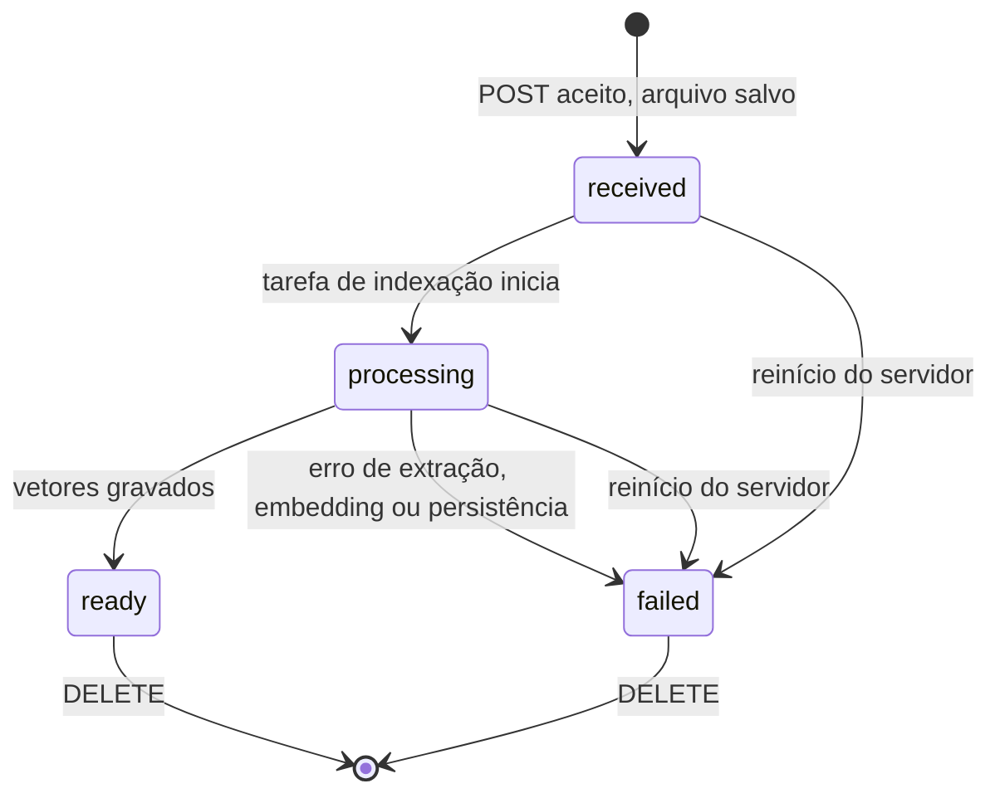

# API

Todos os endpoints ficam sob `/api/v1`, trocam JSON (exceto o upload multipart) e retornam erros no envelope padrão. Depois de implementado, o OpenAPI gerado pelo FastAPI é a fonte de verdade.

## Endpoints

| Método | Caminho | Sucesso | Erros esperados |
| --- | --- | --- | --- |
| GET | `/health` | `200 {"status": "ok"}` | — |
| POST | `/documents` (campo `file`) | `202` + `Document` + `warning` | `413`, `422` |
| GET | `/documents` | `200 {"items": [Document], "embedding_model_changed": bool}` | — |
| GET | `/documents/{document_id}` | `200` + `Document` | `404` |
| DELETE | `/documents/{document_id}` | `204` | `404`, `409`, `500` |
| POST | `/chat/query` | `200` + `ChatResponse` | `422`, `409`, `502`, `504` |
| POST | `/chat/query/stream` | `200` + SSE (`text/event-stream`) | `422`, `409`, `502`, `504` (JSON, antes do stream) |

## Schemas

**`Document`** — `id` é UUID v4; `storage_path` nunca é retornado.

```json
{
  "id": "8f3c2a1e-...",
  "filename": "manual.pdf",
  "status": "ready",
  "error_code": null,
  "error_message": null,
  "page_count": 42,
  "chunk_count": 118,
  "created_at": "2026-11-03T15:08:00Z",
  "updated_at": "2026-11-03T15:08:41Z"
}
```

**`ChatRequest`** — cada pergunta é independente; nunca inclui mensagens anteriores.

```json
{
  "question": "Qual é o procedimento de reinicialização?",
  "document_ids": ["8f3c2a1e-..."],
  "show_sources": false
}
```

- `show_sources` (opcional, `bool`, default `true` no `/chat/query`): omitir o campo equivale a `true`, então clientes existentes não mudam. O frontend envia o campo explicitamente em toda consulta.
- Com `show_sources=true` (ou omitido): comportamento atual exato — mesmo pipeline estruturado, `answer` com marcadores `[n]` escritos pelo código e `sources` com as fontes citadas.
- Com `show_sources=false`: o mesmo pipeline estruturado (camadas 1 e 2 da regra de evidência intactas), mas `answer` vem sem marcadores `[n]` (claims válidos em texto corrido; parágrafos fixos de partes não encontradas e de claims não vinculados mantidos) e `sources: []`.

**`ChatResponse`** — `index` corresponde ao marcador `[n]` em `answer`, numerado de 1 a m na ordem da primeira aparição; `page` pode ser `null`. Só as fontes citadas são retornadas.

```json
{
  "answer": "Desligue o equipamento e aguarde 30 segundos [1].",
  "has_evidence": true,
  "sources": [
    {
      "index": 1,
      "document_id": "8f3c2a1e-...",
      "filename": "manual.pdf",
      "page": 12,
      "excerpt": "Trecho recuperado do documento..."
    }
  ]
}
```

Se algum `document_id` não existir ou não estiver `ready`, a API retorna `409 document_not_ready` sem consultar o modelo.

## Streaming sem fontes (`POST /chat/query/stream`)

Sempre responde sem fontes (PRD §12.6). O corpo é um `ChatRequest` com o default de `show_sources` trocado para `false` nesta rota (schema derivado `ChatStreamRequest`): a omissão já responde sem fontes; enviar `show_sources: true` explicitamente retorna `422 stream_sources_unsupported`, porque o endpoint não gera citações.

Sucesso: `200`, `Content-Type: text/event-stream`, `Cache-Control: no-cache`. Cada evento é uma linha `data: {json}\n\n`:

```text
data: {"type": "delta", "text": "Desligue o equipamento e aguarde 30 segundos."}

data: {"type": "delta", "text": " Depois, mantenha o botão de energia pressionado por 5 segundos."}

data: {"type": "done", "has_evidence": true}
```

- `delta.text` já vem filtrado (sem marcadores `[n]`, com limpeza local de espaços nos pontos de remoção) e é **markdown** (títulos curtos, negrito, itálico, listas, código em linha e em bloco — sem tabelas, links, imagens ou HTML). Os deltas concatenados formam a resposta completa.
- `done` ocorre exatamente uma vez e é o último evento de um stream bem-sucedido. `has_evidence: false` só no caso da resposta fixa de RF-14, que chega como um único delta seguido de `done` (camada 1 decidida em código, sem chamar o modelo). No caminho de geração a camada 2 não se aplica (não há citações a validar; PRD §12.7).
- `error` carrega o envelope padrão (`code` estável, `message` pt-BR) e encerra o stream:

```text
data: {"type": "error", "error": {"code": "provider_error", "message": "O serviço de IA não respondeu corretamente. Tente novamente."}}
```

- Erros detectados **antes** do primeiro evento (validação `422`, documento não pronto `409`, falha ou timeout na recuperação `502`/`504`, `show_sources=true`) voltam como resposta JSON comum com o status correto — o stream ainda não começou. Falhas do provedor **durante** a geração viram evento `error` (o status 200 já foi comprometido); o texto parcial já recebido permanece válido no cliente.
- Cliente desconecta (`AbortController`, aba fechada): o backend encerra o gerador e a iteração do modelo (cancelamento real), e nada além de IDs, contagens e durações vai para o log.
- O log `query_done` ganha `show_sources`, `stream` e `first_token_ms` (apenas no caminho de stream; nunca conteúdo).

## Upload

- Um PDF por vez, via multipart.
- Rejeitar: arquivo vazio, extensão diferente de `.pdf`, assinatura inicial diferente de `%PDF-`, tamanho acima de `MAX_UPLOAD_MB`, PDF criptografado, páginas acima de `MAX_PDF_PAGES`.
- Duplicados (mesmo SHA-256) são aceitos como documentos distintos, com o aviso "Este arquivo já foi enviado." O aviso vem no campo `warning` da resposta do upload (`null` quando não é duplicado).
- `GET /documents` retorna `embedding_model_changed: true` enquanto existir vetor gerado com outro `EMBEDDING_MODEL`. A UI mostra "O modelo de indexação mudou. Remova e envie os documentos novamente." (texto em `locales/pt-BR.ts`).

## Estados do documento



Nenhuma transição fora do diagrama é permitida. Documento em `processing` não pode ser removido (`409`).

| Valor na API | Rótulo na UI | Cor do badge | Ícone |
| --- | --- | --- | --- |
| `received` | Recebido | `text-secondary` | relógio |
| `processing` | Processando | `warning` | spinner |
| `ready` | Pronto | `success` | check |
| `failed` | Falhou | `danger` | alerta |

## Envelope de erro

```json
{
  "error": {
    "code": "file_too_large",
    "message": "O arquivo excede o limite de 20 MB."
  }
}
```

- `code`: estável, em inglês, usado pela lógica do frontend.
- `message`: pt-BR, segura para exibir.
- Um handler global converte qualquer exceção não tratada em `500 internal_error`.
- Nunca expor stack trace, caminho de arquivo ou mensagem crua do provedor.

| `code` | HTTP | Mensagem pt-BR |
| --- | --- | --- |
| `file_empty` | 422 | O arquivo está vazio. |
| `file_not_pdf` | 422 | Envie um arquivo PDF válido. |
| `file_too_large` | 413 | O arquivo excede o limite de {n} MB. |
| `pdf_encrypted` | 422 | PDFs protegidos por senha não são suportados. |
| `pdf_too_many_pages` | 422 | O PDF excede o limite de {n} páginas. |
| `pdf_no_text` | (estado `failed`) | Este PDF não contém texto pesquisável. PDFs digitalizados ainda não são suportados. |
| `document_not_found` | 404 | Documento não encontrado. |
| `document_processing` | 409 | Aguarde o fim do processamento para remover este documento. |
| `document_not_ready` | 409 | Um ou mais documentos selecionados não estão prontos. |
| `question_invalid` | 422 | Escreva uma pergunta entre 3 e {n} caracteres. |
| `provider_error` | 502 | O serviço de IA não respondeu corretamente. Tente novamente. |
| `provider_timeout` | 504 | O serviço de IA demorou demais para responder. Tente novamente. |
| `delete_partial` | 500 | Não foi possível concluir a remoção. Tente novamente. |
| `internal_error` | 500 | Ocorreu um erro inesperado. Tente novamente. |
| `stream_sources_unsupported` | 422 | O endpoint de streaming não exibe fontes; use /chat/query. |
