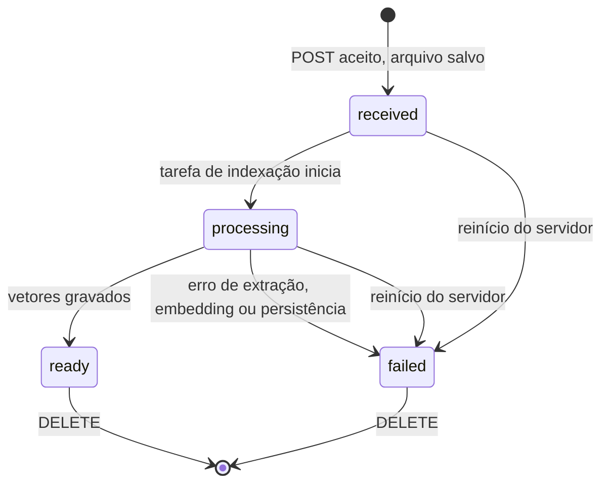

# API

Todos os endpoints ficam sob `/api/v1`, trocam JSON (exceto o upload multipart) e retornam erros no envelope padrão. Depois de implementado, o OpenAPI gerado pelo FastAPI é a fonte de verdade.

## Endpoints

| Método | Caminho | Sucesso | Erros esperados |
| --- | --- | --- | --- |
| GET | `/health` | `200 {"status": "ok"}` | — |
| POST | `/documents` (campo `file`) | `202` + `Document` + `warning` | `413`, `422` |
| GET | `/documents` | `200 {"items": [Document], "embedding_model_changed": bool}` | — |
| GET | `/documents/{document_id}` | `200` + `Document` | `404` |
| DELETE | `/documents/{document_id}` | `204` | `404`, `409`, `500` |
| POST | `/chat/query` | `200` + `ChatResponse` | `422`, `409`, `502`, `504` |

## Schemas

**`Document`** — `id` é UUID v4; `storage_path` nunca é retornado.

```json
{
  "id": "8f3c2a1e-...",
  "filename": "manual.pdf",
  "status": "ready",
  "error_code": null,
  "error_message": null,
  "page_count": 42,
  "chunk_count": 118,
  "created_at": "2026-11-03T15:08:00Z",
  "updated_at": "2026-11-03T15:08:41Z"
}
```

**`ChatRequest`** — cada pergunta é independente; nunca inclui mensagens anteriores.

```json
{
  "question": "Qual é o procedimento de reinicialização?",
  "document_ids": ["8f3c2a1e-..."]
}
```

**`ChatResponse`** — `index` corresponde ao marcador `[n]` em `answer`; `page` pode ser `null`. Só as fontes citadas são retornadas.

```json
{
  "answer": "Desligue o equipamento e aguarde 30 segundos [1].",
  "has_evidence": true,
  "sources": [
    {
      "index": 1,
      "document_id": "8f3c2a1e-...",
      "filename": "manual.pdf",
      "page": 12,
      "excerpt": "Trecho recuperado do documento..."
    }
  ]
}
```

Se algum `document_id` não existir ou não estiver `ready`, a API retorna `409 document_not_ready` sem consultar o modelo.

## Upload

- Um PDF por vez, via multipart.
- Rejeitar: arquivo vazio, extensão diferente de `.pdf`, assinatura inicial diferente de `%PDF-`, tamanho acima de `MAX_UPLOAD_MB`, PDF criptografado, páginas acima de `MAX_PDF_PAGES`.
- Duplicados (mesmo SHA-256) são aceitos como documentos distintos, com o aviso "Este arquivo já foi enviado." O aviso vem no campo `warning` da resposta do upload (`null` quando não é duplicado).
- `GET /documents` retorna `embedding_model_changed: true` enquanto existir vetor gerado com outro `EMBEDDING_MODEL`. A UI mostra "O modelo de embeddings mudou. Remova e envie os documentos novamente." (texto em `locales/pt-BR.ts`).

## Estados do documento



Nenhuma transição fora do diagrama é permitida. Documento em `processing` não pode ser removido (`409`).

| Valor na API | Rótulo na UI | Cor do badge | Ícone |
| --- | --- | --- | --- |
| `received` | Recebido | `text-secondary` | relógio |
| `processing` | Processando | `warning` | spinner |
| `ready` | Pronto | `success` | check |
| `failed` | Falhou | `danger` | alerta |

## Envelope de erro

```json
{
  "error": {
    "code": "file_too_large",
    "message": "O arquivo excede o limite de 20 MB."
  }
}
```

- `code`: estável, em inglês, usado pela lógica do frontend.
- `message`: pt-BR, segura para exibir.
- Um handler global converte qualquer exceção não tratada em `500 internal_error`.
- Nunca expor stack trace, caminho de arquivo ou mensagem crua do provedor.

| `code` | HTTP | Mensagem pt-BR |
| --- | --- | --- |
| `file_empty` | 422 | O arquivo está vazio. |
| `file_not_pdf` | 422 | Envie um arquivo PDF válido. |
| `file_too_large` | 413 | O arquivo excede o limite de {n} MB. |
| `pdf_encrypted` | 422 | PDFs protegidos por senha não são suportados. |
| `pdf_too_many_pages` | 422 | O PDF excede o limite de {n} páginas. |
| `pdf_no_text` | (estado `failed`) | Este PDF não contém texto pesquisável. PDFs digitalizados ainda não são suportados. |
| `document_not_found` | 404 | Documento não encontrado. |
| `document_processing` | 409 | Aguarde o fim do processamento para remover este documento. |
| `document_not_ready` | 409 | Um ou mais documentos selecionados não estão prontos. |
| `question_invalid` | 422 | Escreva uma pergunta entre 3 e {n} caracteres. |
| `provider_error` | 502 | O serviço de IA não respondeu corretamente. Tente novamente. |
| `provider_timeout` | 504 | O serviço de IA demorou demais para responder. Tente novamente. |
| `delete_partial` | 500 | Não foi possível concluir a remoção. Tente novamente. |
| `internal_error` | 500 | Ocorreu um erro inesperado. Tente novamente. |
